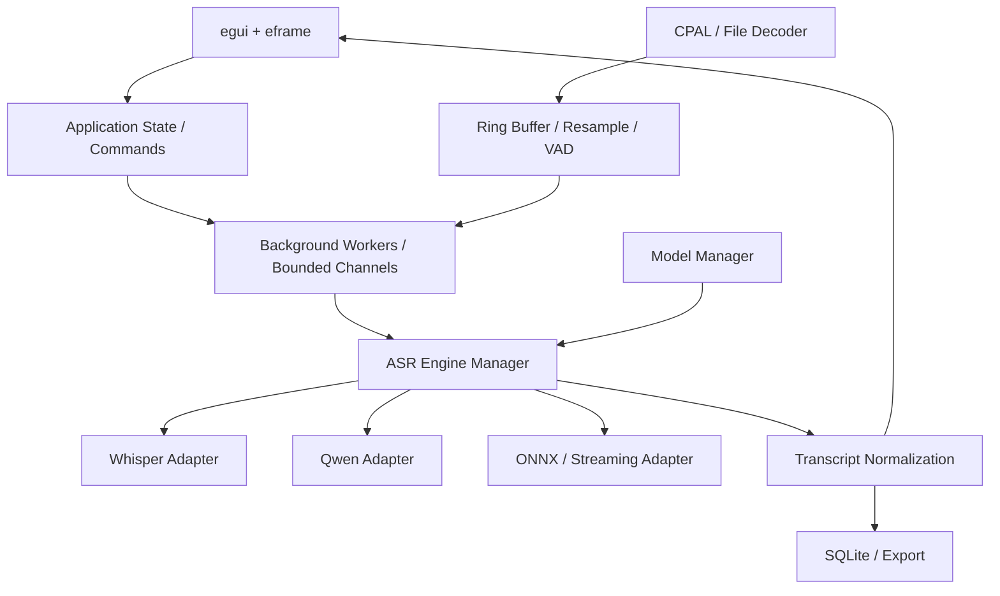

# Speech-to-Text V2 — Đề xuất kiến trúc Rust + egui

Ngày: 25/11/2026 | Trạng thái: Định hướng kỹ thuật, cần POC và benchmark trước khi triển khai production.

## 1. Tổng quan và quyết định

Ứng dụng hiện tại sử dụng Rust cho backend, TypeScript cho giao diện và Whisper Large V3 Turbo cho nhận dạng giọng nói. Mục tiêu nâng cấp là tối ưu tiếng Việt, chạy local/offline, giảm overhead giao diện và tránh phụ thuộc vào một họ model.

| Thành phần | Định hướng |
|---|---|
| Ngôn ngữ | Rust |
| UI | egui + eframe |
| Renderer | wgpu hoặc glow, chọn theo benchmark |
| Kiến trúc | Cargo Workspace, modular monolith |
| Inference | Multi-model ASR với adapter độc lập |
| Balanced | Qwen3-ASR-0.6B, ứng viên mặc định |
| High Accuracy | Qwen3-ASR-1.7B, ứng viên |
| Tiếng Việt chuyên biệt | ChunkFormer, BuzzASR, PhoWhisper, cần kiểm chứng |
| Streaming | VietASR Zipformer, cần kiểm chứng |
| Lightweight | Moonshine Base VI, cần xác minh checkpoint và hỗ trợ tiếng Việt |
| Fallback | Whisper Large V3 Turbo hiện tại |
| Audio | CPAL, Rubato, ring buffer, VAD |
| Storage | SQLite |
| Concurrency | Worker threads, bounded channels, Tokio cho I/O |
| Deployment | Native desktop, local-first |

Rust + egui là định hướng ưu tiên nghiên cứu, không phải yêu cầu rewrite ngay. Giữ giao diện TypeScript hiện tại cho đến khi POC đạt tiêu chí nghiệm thu. Thay UI không tự động tăng tốc inference.

## 2. Vì sao chọn egui

- Một hệ sinh thái Rust, không cần WebView hoặc Tauri IPC cho giao diện mới.
- Phù hợp desktop utility, ghi âm nhanh, system tray, global hotkey và transcript đơn giản.
- Có tiềm năng giảm RAM dành cho UI và thời gian khởi động; cần đo thực tế.
- Immediate-mode UI cần kiểm soát repaint, layout và chi phí hiển thị transcript dài.
- Điểm đánh đổi: rich text, accessibility, IME tiếng Việt, animation và component library cần đầu tư thêm. Nếu sản phẩm thiên về trình soạn thảo phức tạp, React + TypeScript vẫn là lựa chọn hợp lý.

## 3. Kiến trúc tổng thể



### Nguyên tắc thiết kế

- UI thread chỉ render và xử lý tương tác; inference chạy ở worker riêng.
- Audio callback không thực hiện inference, disk I/O, network hoặc tác vụ blocking.
- Dùng ring buffer và bounded channels; phát hiện overflow và thông báo mất audio thay vì bỏ âm thầm.
- Phân biệt partial transcript (có thể sửa) và final transcript (đã xác nhận).
- Hạn chế số model load đồng thời; chuyển model an toàn khi không có phiên đang chạy.
- Tách model registry, model download và engine runtime khỏi UI.
- Không tự động gửi audio lên cloud. Mọi tính năng mạng liên quan dữ liệu người dùng phải được opt-in rõ ràng.

## 4. Lựa chọn model ASR

| Model | Vai trò | Việc cần xác minh |
|---|---|---|
| Whisper Large V3 Turbo | Baseline, fallback | Ghi nhận cấu hình quantization và runtime hiện tại |
| Qwen3-ASR-0.6B | Balanced | WER, latency, RAM, hỗ trợ CPU/Metal và tiếng Việt |
| Qwen3-ASR-1.7B | High Accuracy | Chất lượng, tài nguyên, timestamp và code-switching |
| ChunkFormer tiếng Việt | Vietnamese specialist | Checkpoint, ONNX/export, punctuation, runtime Rust |
| BuzzASR Vietnamese | Vietnamese specialist | Nguồn checkpoint, license, chất lượng, chuyển đổi Whisper |
| PhoWhisper Large | Baseline tiếng Việt | Tốc độ, RAM, tương thích whisper.cpp |
| VietASR Zipformer | Streaming | ONNX checkpoint, true streaming, endpointing |
| Moonshine Base VI | Lightweight | Sự tồn tại và chất lượng checkpoint tiếng Việt, hỗ trợ runtime |
| Cohere Transcribe / Parakeet | Nghiên cứu bổ sung | Hỗ trợ tiếng Việt của checkpoint cụ thể và license |

Không coi model mới hơn là tốt hơn mặc định. Chỉ chốt model production khi vượt baseline trên bộ audio thực tế. Các số WER công khai từ bộ dữ liệu khác nhau không được dùng để xếp hạng trực tiếp. Tài liệu này không khẳng định các checkpoint chưa kiểm chứng đã tương thích hay tốt hơn Whisper.

## 5. Inference engine

| Engine | Mục đích | Ưu tiên |
|---|---|---|
| whisper-rs / whisper.cpp | Giữ baseline và họ Whisper tương thích | P0 |
| transcribe.cpp / Rust bindings | POC multi-model | P1, xác minh repo/API/checkpoint |
| transcribe-rs | POC thay thế multi-engine | P1 |
| Qwen Rust runtimes / Candle | Adapter Qwen chuyên biệt nếu cần | P1 |
| sherpa-onnx / sherpa-rs | Streaming và ONNX | P2 |
| ort | ONNX Runtime trực tiếp nếu adapter cần | Có điều kiện |

Không cài tất cả inference framework cùng lúc. Dùng Cargo features để bật engine theo nền tảng và gói phát hành. Kiểm tra license của từng model, runtime, native library và trọng số quantized trước phân phối.

```rust
pub trait AsrEngine: Send {
    fn load(&mut self, config: &ModelConfig) -> Result<(), AsrError>;
    fn transcribe(&mut self, audio: &[f32]) -> Result<Transcript, AsrError>;
    fn capabilities(&self) -> EngineCapabilities;
    fn unload(&mut self);
}

pub trait StreamingSession: Send {
    fn push_audio(&mut self, samples: &[f32]) -> Result<Vec<TranscriptEvent>, AsrError>;
    fn finish(&mut self) -> Result<Transcript, AsrError>;
}
```

Đây là interface minh họa, chưa phải code chạy hoàn chỉnh. ModelConfig nên chứa model ID, backend, device, precision, language và decoding options. Capabilities khai báo streaming, timestamps, language detection và hotwords nếu thực sự hỗ trợ. Không giả lập true streaming bằng cách gắn nhãn cho batch inference.

## 6. Dependencies Rust

| Package | Chức năng | Mức ưu tiên |
|---|---|---|
| egui, eframe | UI và desktop runtime | Bắt buộc |
| egui_plot | Waveform | Cao |
| egui_extras | Table, layout | Theo UI |
| egui_dock | Dockable workspace | Tùy chọn |
| rfd | Native file picker | Cao |
| cpal | Microphone capture | Cao |
| rubato | Resample | Cao |
| symphonia | Decode file audio | Cao |
| rodio | Playback | Theo tính năng |
| ringbuf | Audio buffering | Cao |
| crossbeam-channel | Worker commands/events | Cao |
| tokio | Async I/O, model download | Cao |
| rusqlite | SQLite | Cao |
| serde, serde_json | Config, metadata | Cao |
| tracing, tracing-subscriber | Logging | Cao |
| reqwest | Model download | Theo tính năng |
| sha2 | Kiểm tra checksum model | Cao khi tải model |
| thiserror | Typed errors | Cao |
| criterion | Microbenchmark | Dev dependency |
| global-hotkey, tray-icon, arboard | Hotkey, tray, clipboard | Tùy chọn |

Không khóa version trong tài liệu khi chưa rà soát Cargo.toml hiện tại. Chọn các phiên bản tương thích egui/eframe/egui_plot và MSRV; pin Cargo.lock cho ứng dụng. Chọn VAD sau POC (ví dụ Silero ONNX hoặc VAD hiện tại).

## 7. Cấu trúc source code

```text
speech-to-text/
├── Cargo.toml
├── Cargo.lock
├── crates/
│   ├── app/
│   ├── ui/              # screens, components, theme, widgets
│   ├── audio/           # capture, decode, playback, resample, vad
│   ├── asr-core/        # traits, capabilities, transcript events
│   ├── asr-whisper/
│   ├── asr-qwen/
│   ├── asr-onnx/
│   ├── model-manager/
│   ├── storage/
│   ├── transcript/
│   └── platform/        # tray, hotkeys, permissions
├── assets/fonts/
├── assets/icons/
├── benchmarks/
├── tests/fixtures/
└── docs/
```

Workspace là cấu trúc đích; giai đoạn đầu có thể gộp crate nhỏ để tránh overengineering. Không để asr-core phụ thuộc egui hoặc TypeScript.

## 8. UI/UX và chức năng

Các chế độ đề xuất: Balanced, High Accuracy, Vietnamese Specialist, Streaming/Ultra Fast và Compatibility. Chỉ hiển thị chế độ khi engine và checkpoint tương ứng đã được xác minh. Cho phép chọn model nâng cao nếu cần.

Màn hình chính: nút ghi âm/dừng, trạng thái microphone, waveform, transcript partial/final, copy và export. Màn hình lịch sử: tìm kiếm, phát lại nếu có audio lưu, xóa phiên. Model Manager: dung lượng, trạng thái download, checksum, device, model đang dùng và khả năng gỡ. Settings: microphone, ngôn ngữ, hotkey, theme, tùy chọn lưu audio.

Kiểm tra Telex, VNI, IME composition, Unicode NFC, font tiếng Việt, clipboard, selection, keyboard navigation và accessibility trên macOS/Windows/Linux mục tiêu. Transcript dài dùng virtualized rows; không layout toàn bộ tài liệu mỗi frame. Chỉ repaint khi có sự kiện hoặc animation cần thiết. Benchmark wgpu/glow khi inference đang sử dụng GPU.

## 9. Model Manager, storage và bảo mật

- Registry lưu model ID, version/revision, checksum, nguồn tải, license, capabilities, precision, runtime và dung lượng.
- Download vào file tạm, kiểm tra SHA-256, sau đó atomic rename; hỗ trợ hủy và retry. Không tải model tùy ý từ nguồn không tin cậy.
- SQLite lưu sessions, segments, model metadata, settings và migration version. Dùng transaction khi ghi final segments, kiểm tra busy timeout và WAL khi phù hợp.
- Audio gốc chỉ lưu khi có tùy chọn rõ ràng; lưu tại thư mục dữ liệu riêng của ứng dụng. Cung cấp xóa lịch sử và audio.
- Log không chứa nội dung transcript/audio mặc định. Bảo vệ dữ liệu export; SQLite thông thường không mã hóa dữ liệu at rest, cần giải pháp riêng nếu yêu cầu bảo mật cao.
- Export TXT, JSON, SRT/VTT nếu có timestamp hợp lệ. Không tự tạo timestamp thiếu căn cứ.

## 10. Benchmark và tiêu chí nghiệm thu

Tạo corpus 5–10 giờ, có transcript chuẩn, tách dữ liệu tuning và test. Tỷ trọng gợi ý: Bắc 15%, Trung 15%, Nam 20%, code-switching 15%, nhiều người 10%, nhiễu 10%, audio dài 10%, thuật ngữ 5%. Đây là nhóm chính để phân bổ, có thể gắn nhiều nhãn phụ cho một audio.

| Metric | Mục tiêu đề xuất |
|---|---|
| WER | Giảm >=15% tương đối so với Turbo cho model thay thế |
| CER | Không kém baseline |
| RTF | <0.5 cho Balanced trên máy mục tiêu |
| First partial latency | <500ms nếu true streaming, đo rõ từ mốc audio nào |
| Peak RAM / VRAM | Không tăng đáng kể ở Balanced; ghi số tuyệt đối |
| Cold start | Đo thời gian khởi tạo UI và load model riêng |
| Hallucination | Giảm lỗi trên silence/noise |
| Code-switching | Đo WER riêng và lỗi thuật ngữ |
| Timestamp | Không suy giảm nếu tính năng bắt buộc |
| UI responsiveness | Không freeze khi inference, đo frame latency |
| Battery / CPU / GPU | Đo trên phiên chạy liên tục |

WER = (S + D + I) / N. RTF = thời gian xử lý / thời lượng audio. Báo cáo WER raw và normalized theo quy tắc thống nhất (dấu câu, số, case, Unicode), giữ nguyên dấu tiếng Việt. Đo p50/p95 latency, RAM idle và peak toàn bộ process tree, model size và installer size. Ghi hardware, OS, runtime, quantization, threads, decoding, VAD. Warm-up và lặp lại nhiều lần.

Ưu tiên benchmark Mac Apple Silicon (Metal/CPU) và Windows CPU-only nếu phân phối đa nền tảng. So sánh egui và TypeScript trên cùng model, runtime, corpus và tính năng. Chỉ rewrite UI nếu đạt cải thiện có ý nghĩa hoặc đơn giản hóa bảo trì đủ lớn, đồng thời không mất tính năng cần thiết.

## 11. Roadmap và migration

| Giai đoạn | Công việc | Điều kiện hoàn thành |
|---|---|---|
| P0 | Inventory source, baseline Turbo, tách ASR core | Benchmark tái lập được, không phá UI cũ |
| P1 | POC egui + Qwen 0.6B/1.7B + multi-model runtime | UI phản hồi tốt, model chạy ổn định, có số đo |
| P2 | Benchmark ChunkFormer, PhoWhisper, BuzzASR và streaming | Chọn checkpoint theo chất lượng, license, runtime |
| P3 | Hoàn thiện UI, model manager, SQLite, export | Feature parity cần thiết, test tiếng Việt |
| P4 | Đóng gói, signing, permissions, update, rollback | Smoke test trên OS mục tiêu, kiểm tra bảo mật |

Giữ nhánh release TypeScript trong thời gian migration. Dùng chung ASR core cho cả hai UI khi khả thi; có cơ chế rollback về Turbo và phiên bản ứng dụng cũ. Không ép migrate dữ liệu không thể đảo ngược trước khi sao lưu.

## 12. Tài liệu tham khảo và giới hạn

- egui: https://github.com/emilk/egui — demo https://www.egui.rs/
- Qwen3-ASR: https://github.com/QwenLM/Qwen3-ASR
- PhoWhisper: https://github.com/VinAIResearch/PhoWhisper
- ChunkFormer: https://github.com/khanhld/chunkformer
- whisper.cpp: https://github.com/ggml-org/whisper.cpp
- whisper-rs: https://github.com/tazz4843/whisper-rs
- sherpa-onnx: https://github.com/k2-fsa/sherpa-onnx
- transcribe-rs: https://github.com/cjpais/transcribe-rs
- transcribe.cpp (ứng viên POC từ đề xuất trước): https://github.com/handy-computer/transcribe.cpp

Các đường dẫn và khả năng tương thích cần được xác minh tại thời điểm POC. Tài liệu tổng hợp các đề xuất đã trao đổi, không phải kết quả benchmark mới. Chưa có source code, cấu hình máy đích, runtime hiện tại hoặc dữ liệu thực tế để khẳng định model tối ưu. Không sử dụng điểm benchmark công khai chưa được kiểm chứng làm quyết định production.

**Kết luận:** ưu tiên kiến trúc Rust + egui, local-first, modular ASR. Giữ Whisper Turbo làm baseline/fallback; thử Qwen3-ASR trước, tiếp theo các model chuyên biệt tiếng Việt và streaming. Quyết định rewrite UI và chọn model mặc định sau khi POC đạt tiêu chí.
